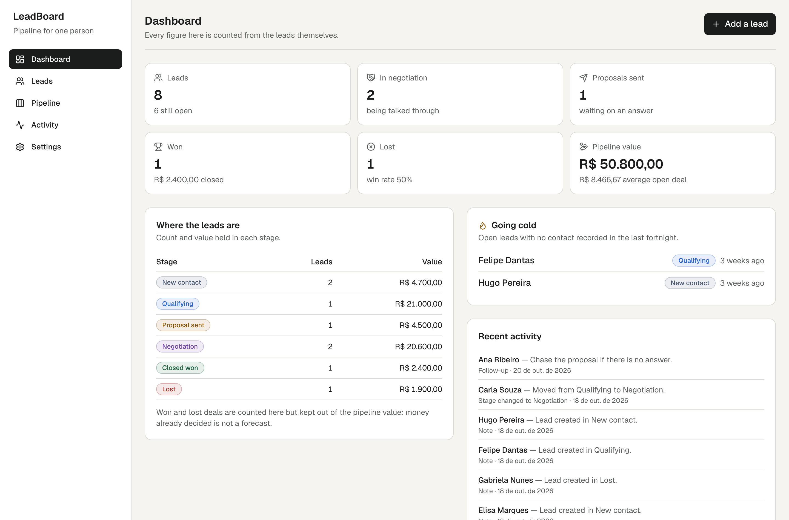
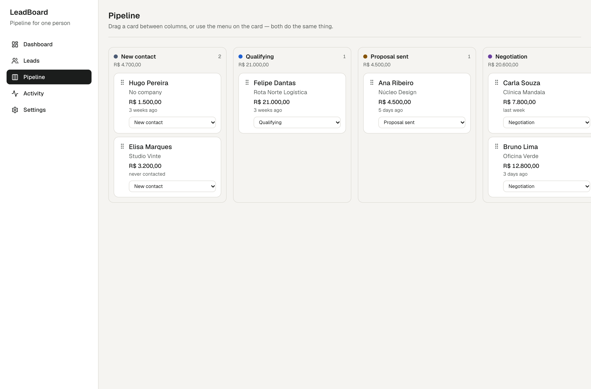

# LeadBoard

A small CRM for one person: leads, a six-stage pipeline, a history of
every call and note, and a CSV export.



## Running it

```bash
npm install
npm run db:migrate   # creates data/leadboard.db
npm run db:seed      # optional: eight invented leads
npm run dev
```

| Command | What it does |
| --- | --- |
| `npm run dev` | development server |
| `npm run build` | production build, type checked |
| `npm test` | 97 unit and interface tests |
| `npm run lint` / `npm run typecheck` | ESLint, then TypeScript strict with `noUncheckedIndexedAccess` |
| `npm run db:migrate` / `npm run db:seed` | apply migrations, load the example pipeline |
| `npm run verify:ui` | axe, overflow and console checks in a real browser at four widths |

`verify:ui` needs the built app running:

```bash
npm run build && npm run start -- --port 5411
VERIFY_URL=http://localhost:5411 npm run verify:ui
```

## Two places the data can live

This is the decision that shaped the whole codebase, so it is worth
stating plainly.

| | Local (`database`) | Deployed (`demo`) |
| --- | --- | --- |
| Store | SQLite file through Drizzle | the visitor's own browser |
| Written by | server actions | the page itself |
| Survives | yes, on that machine | until that browser's data is cleared |
| Shared between people | no | no |

**A SQLite file on a serverless host is not storage.** The instance that
wrote it may not exist for the next request, and the loss would be
silent — the worst kind. So the deployed demonstration keeps each
visitor's leads in their own browser and says so on every page. That
also means no visitor can see another's pipeline, which a single shared
server store would not give you.

Both stores implement the same `LeadRepository` interface and are held
to the same 16-test contract, so the application code above them does
not know which one it is writing to. Set `NEXT_PUBLIC_DATA_MODE` to
`database` or `demo` to choose; without it, `NEXT_PUBLIC_SERVERLESS=true`
selects the demonstration.

## What it does

- **Dashboard** — leads, open deals, proposals out, won and lost, the
  value of the open pipeline, which leads are going cold, and the
  recent history. Every figure is counted from the leads themselves.
- **Leads** — create, edit and delete with a confirmation, search by
  name or company, filter by stage and source, and order five ways.
- **Pipeline** — six columns, drag between them, with a stage menu on
  every card that does the same thing.
- **Activity** — calls, notes, stage changes and follow-ups, grouped by
  day, filterable by kind.
- **Settings** — currency, export, and where the data lives.



## Decisions worth knowing

- **Money is an integer number of cents**, from the form to the
  database column, which carries a `CHECK` that it is not negative. A
  `REAL` column would make the pipeline total drift for no traceable
  reason.
- **Won and lost deals are kept out of the pipeline value.** Money
  already decided is not a forecast.
- **The win rate is null, not zero, until something has been decided.**
  A rate out of nothing is not a rate.
- **Drag and drop is the shortcut, not the mechanism.** Every card
  carries a visible stage menu, because dragging is unusable with a
  keyboard, awkward with a screen reader and fiddly with a thumb. Each
  move is announced in a live region.
- **Changing the currency relabels and never converts.** The same
  stored number under another symbol is not a conversion, and the
  settings page says so.
- **Exported cells beginning `=` `+` `-` `@` leave with an apostrophe.**
  A phone number written `+55 81 ...` is exactly such a cell.
- **Validation is one schema**, run by the form and again by the server
  action, so a value cannot be accepted by one route and refused by the
  other.

## Privacy

There is no account system and no authentication, so nothing here is
protected by a login. Do not put a real client list into the deployed
demonstration: use it locally, where the database is a file on your own
machine.

The example pipeline is invented — made-up companies, addresses on
`example.com`, unallocated phone numbers. No real person or business
appears in this repository, and no figure in it is presented as a
result anyone achieved.

## Built with

Next.js 16 (App Router), React 19, TypeScript strict, Tailwind CSS v4,
Drizzle ORM with better-sqlite3, Zod, Vitest, Testing Library,
Playwright and axe-core.
