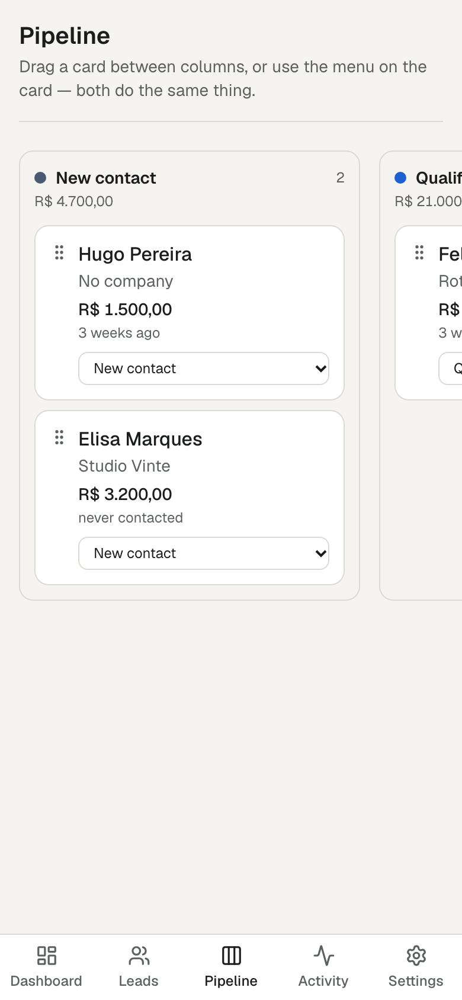

# LeadBoard — case study

**A CRM that tells you where your data actually lives.**

Next.js 16 · React 19 · TypeScript strict · Tailwind v4 · Drizzle +
SQLite · Zod · 97 tests · axe clean at four widths

---

## The problem behind the brief

The brief asked for a small CRM with SQLite, and to deploy a
demonstration of it. Those two things are in direct conflict, and the
conflict is the interesting part of this project.

A serverless deployment has no disk that survives. Write a lead to
`data/leadboard.db` on Vercel and it may be gone on the next request,
because the next request may run on a different instance. Nothing
errors. The lead simply is not there any more.

A CRM that loses a lead without saying so is worse than no CRM.

## What was built instead of pretending

One interface, three implementations, one contract test.

```ts
export interface LeadRepository {
  listLeads(query?: LeadQuery): Promise<Lead[]>;
  getLead(id: string): Promise<Lead | null>;
  createLead(input: LeadInput): Promise<Lead>;
  updateLead(id: string, input: LeadInput): Promise<Lead>;
  moveLead(id: string, stage: Stage): Promise<Lead>;
  deleteLead(id: string): Promise<void>;
  listActivities(leadId?: string, limit?: number): Promise<Activity[]>;
  addActivity(input: ActivityInput): Promise<Activity>;
  clear(): Promise<void>;
}
```

- **SQLite through Drizzle**, used locally through server actions. The
  one that persists.
- **The visitor's own browser**, used by the deployed demonstration.
  Each person's leads are theirs, nothing is sent anywhere, and the
  banner says exactly that.
- **In memory**, which the other two are built on and the tests drive.

The same sixteen-test contract runs against all three. That is what
makes the choice safe rather than a fork: the application code above
the interface cannot tell which store it is talking to, and if the two
ever diverge, a test fails instead of a user's pipeline.

One case shows why the contract earns its keep. The text search was
first written as SQL `LIKE` in the SQLite provider and as an
accent-insensitive comparison in the other. `LIKE` folds case for ASCII
only, so searching "nucleo" would find "Núcleo Design" in the browser
and miss it in the database. The search now runs in TypeScript for both.

## Numbers and dates

Money is an integer number of cents from the input box to the column,
which carries `CHECK (value_cents >= 0)`. Drizzle's text enums are a
TypeScript type and nothing more, so `stage`, `source` and activity
kind carry `CHECK` constraints too — a type does not stop a hand-typed
`INSERT` writing stage `'maybe'`. Foreign keys are switched on
explicitly, because SQLite leaves them off and an activity would
happily outlive the lead it belongs to.

Dates that mean a day are civil-date strings and all arithmetic on them
runs on the UTC calendar. A lead last contacted on "2026-03-17" was
contacted on that day in Recife and in Lisbon alike.

## Accessibility was a build step

The pipeline is the part that usually fails. Drag and drop is unusable
with a keyboard, awkward with a screen reader and fiddly with a thumb,
and the common fix is a keyboard handler bolted on after the fact.

Here the real control is a stage menu on the face of every card, always
visible, and the drag is the shortcut for people who have a mouse. Each
move is announced in a live region, because a card silently reappearing
in another column is feedback only to someone who can see the board.

`scripts/verify-ui.mjs` is committed and runs the built app in a real
browser at 1440, 768, 390 and 320 px across all five routes, then
creates a lead, searches, drags a card, downloads the export and
deletes what it made.

## The two defects only a browser could find

Ninety-seven tests pass. Neither of these was among the things they
could see.

**The phone scrolled 800 pixels sideways into blank paper.** On two
pages. Nothing visible was too wide — every element measured at or
under the viewport, and the horizontal scrollers were clipping
correctly. The cause was the visually hidden labels: `sr-only` is
`position: absolute`, and with no positioned ancestor, their containing
block was the page itself. They escaped the clip of the scroller they
were inside and were laid out at their static position 1,500 pixels
to the right, stretching the document to match. One `relative` on each
scroll container fixed it.

**The amber stage badge failed contrast at 4.03:1.** The palette had
been measured before any CSS was written — which is the right habit —
but against white. The badge actually sits on a 10% tint of its own
colour, which is darker, and that is what axe measures. Measured again
against the real background and darkened to `#855305`.

Both are the same lesson in different clothes: a number computed
against an assumption is not a measurement.

## What it refuses to do

- It does not invent a win rate out of no decided deals.
- It does not count won money as pipeline.
- It does not convert currencies when you relabel them.
- It does not let an export cell execute as a formula in Excel.
- It does not claim the deployed demonstration is storage.



---

Screenshots are captures of the running application with the example
pipeline, which contains no real person or business.
